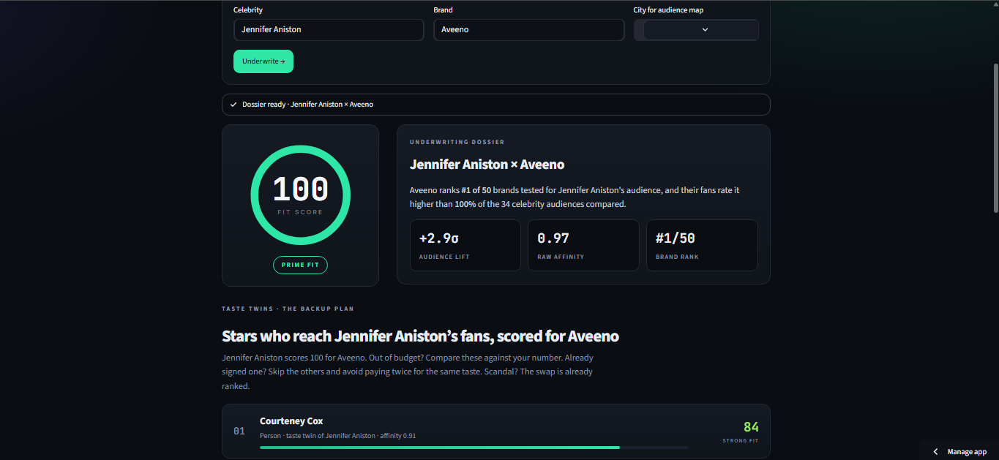
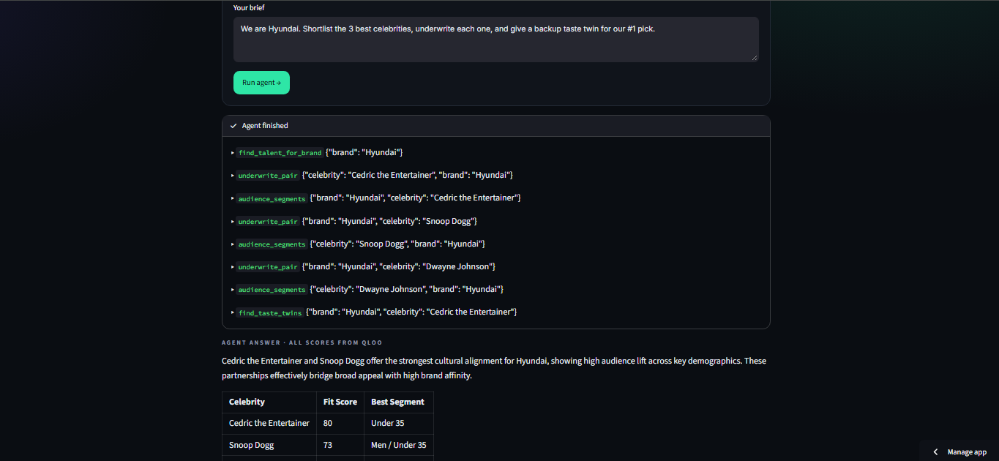
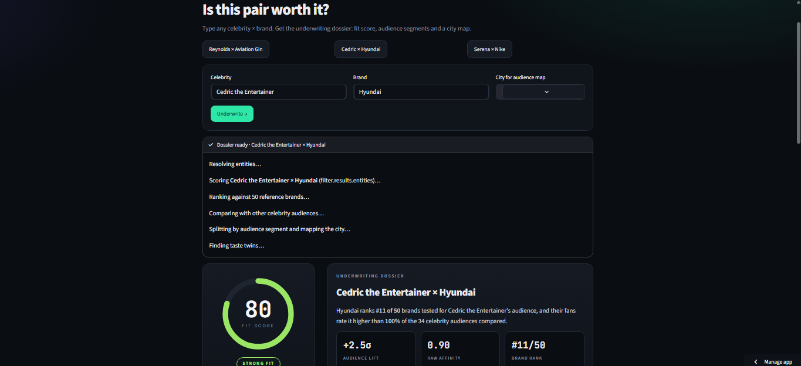
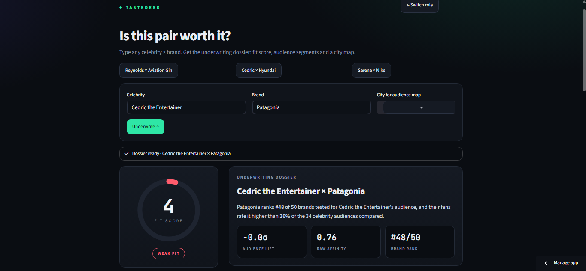

# TasteDesk

**Know the fit before the check is written.**

## The problem

Brands spend millions on celebrity deals. Most of those picks are made on follower counts, gut feel and who the agent knows. When the star's fans do not care about the brand, the whole campaign budget is wasted, and nobody sees it coming.

## The solution

TasteDesk turns that decision into a number. Type a celebrity and a brand and get a Cultural Fit Score from 0 to 100, computed live from Qloo's taste graph. It also shows which age and gender segments drive the fit, where the audience lives in a city, and who the star's taste twins are if you need a backup. A Gemini agent lets you ask for all of it in plain English.

## Why Qloo is necessary

Every number in TasteDesk comes from Qloo. Gemini only plans the steps and writes the summary. Take Qloo out and the app breaks:

- **No Fit Score:** there is no measure of how strongly a star's fans point at a brand.
- **No audience lift:** there are no other celebrity audiences to compare against.
- **No segments or city map:** there is no age or gender split and no heatmap.
- **No taste twins:** there is no lookalike graph to find the backup stars.
- **No agent answers:** the agent's tools all call Qloo, so it would only have guesses to write about.

A plain LLM can guess that Aveeno fits Jennifer Aniston. It cannot measure her fans' taste against 50 brands and 34 celebrity audiences, split that by age and gender, and find her twins.

## What it does

TasteDesk has four entry points:

- **Brands:** "Who do we sign?" Enter a brand and get celebrity audiences ranked by how much their fans over-index on it.
- **Talent agencies:** "Which brands fit my client?" Enter a celebrity and get a pitch list of the brands their fans love most.
- **Ad agencies:** "Is this pair worth it?" Enter a celebrity and a brand and get a fit score, rank, audience lift, segment breakdown, city heatmap and evidence trail.
- **Ask TasteDesk:** describe the deal in plain English. A Gemini agent plans the steps and calls Qloo for every number.

**Taste Twins** sits inside the dossier. For any celebrity it finds the stars whose fans share the same taste (5 people and 5 artists), then scores each one against your brand. Use it when the star is out of budget, when you already signed one twin and want to avoid paying twice for the same taste, or when you need a backup.

## Why it is Qloo-powered

An LLM can guess that Aveeno fits Jennifer Aniston. It cannot measure how strongly her fans' taste points at Aveeno compared with 50 other brands and 34 celebrity audiences, split that by age and gender, map it by city, and find her taste twins. That comes from Qloo's taste graph. Every score in the app is a Qloo result. Without Qloo there is nothing to compute.

Qloo endpoints used:

- `/search` to resolve celebrities and brands
- `/v2/insights` with `signal.interests.entities` and `filter.results.entities` for the pair score
- `/v2/insights` with `filter.type` set to person or artist for taste twins
- `signal.demographics.age` and `signal.demographics.gender` for segments
- `urn:heatmap` with `filter.location.query` for the city map

## How the score works

- **Raw affinity (0 to 1):** Qloo's own score for how closely a celebrity's fans match a brand.
- **Fit Score (0 to 100):** the share of the 50 reference brands that this brand beats for that celebrity. 100 means it beats all of them.
- **Brand rank:** where the brand lands among those 50.
- **Audience lift (σ, "sigma"):** how unusual the result is compared with other celebrity audiences. 0σ is average, +1σ is clearly above average, +2σ is rare (about 1 audience in 50), +3σ is extreme (about 1 in 1,000). It corrects for brands that everyone likes, such as Nike.

## Evidence

### Validation tests (notebook pipeline, `TestDeck.py`)

**Test A: do real signed deals score high?**
We collected publicly documented celebrity and brand deals (founder deals and endorsements). The pipeline resolved 135 celebrities and about 194 brands in Qloo and scored all 25,785 celebrity x brand pairs (about 1,650 API calls). For each deal, we checked where the real brand ranks inside that celebrity's own row of brands. 50% would be chance.

- 53 deals were usable. Average percentile: **0.749**, meaning the real deal brand outranks about 75% of the other brands.
- **27 of 53** deals landed in the top 10% of their celebrity's row, about **5x chance**.
- After removing brand popularity (per-brand z-scores), the deal-versus-non-deal AUC was **0.775**.
- Endorsement deals (n=19): **0.902**. Founder deals (n=34): **0.663**.
- The same pair returned the same score on five repeat calls.
- Top hits: Ryan Reynolds x Aviation Gin ranked #1. Kim Kardashian x SKIMS, Kylie Jenner x Kylie Cosmetics, Tom Brady x TB12, Metallica x Blackened Whiskey, Reese Witherspoon x Draper James and Dwayne Johnson x Teremana also scored high.

**Test B: do Taste Twins hold up?**
For 75 celebrities with documented deals, we pulled Qloo's lookalikes (5 people and 5 artists each), then compared them with random stars as controls. 73 celebrities were usable, with 708 twin rows in total.

- **Taste agreement:** twins share the star's brand taste at **0.73** (Spearman correlation) versus **0.43** for random stars. The gap is +0.31 with a 95% range of +0.26 to +0.35. Twins won for **67 of 73** celebrities.
- **Deal transfer:** the star's real deal brand ranks at the **0.66** percentile for the twins versus **0.50** for random stars (the star herself: 0.74). The gap is +0.16 with a 95% range of +0.11 to +0.21. Twins won on **44 of 56** deals.
- In **40 of 56** deals, at least one twin landed in the top 10% for the same brand (31 of 56 for random controls).

### Live app tests

**Test 1: Jennifer Aniston x Aveeno, with Taste Twins**


*Aveeno is #1 of 50 brands for Aniston's audience, with fit score 100, raw affinity 0.97 and +2.9σ audience lift. Her fans rate it above all 34 celebrity audiences compared. By segment: all fans 0.97, under 35 0.88, 36 to 55 0.90, 55 and over 0.95, women 0.96, men 0.85. Taste twins scored for Aveeno: Courteney Cox 84, Julia Roberts 80.*

**Test 2: the Gemini agent, plain-English brief**
Brief: "We are Hyundai. Shortlist the 3 best celebrities, underwrite each one, and give a backup taste twin for our #1 pick."


*The agent called Qloo tools live and returned: Cedric the Entertainer 80 (best segment: under 35), Snoop Dogg 73 (men, under 35), Dwayne Johnson 59 (men, under 35). Backup for Cedric: Anthony Anderson, fit 86. Every number matches the app's own pages.*

**Test 3: Cedric the Entertainer x Hyundai, and a deliberate mismatch**


*Hyundai tops Cedric's pitch list. Dossier: fit score 80 (strong fit), raw affinity 0.90, +2.5σ audience lift, rank #11 of 50.*


*Cedric x Patagonia: fit score 4 (weak fit), raw affinity 0.76, 0.0σ (exactly average), rank #48 of 50. The app says no when the fit is not there, so its yes means something.*

Why Hyundai is #1 on the pitch list but #11 on the dossier: the pitch list ranks by audience lift, which removes the boost popular brands get. The dossier rank uses raw affinity across the 50 reference brands.

## The Gemini agent

The agent uses **Gemini 3.1 Flash-Lite** through the Gemini REST API with function calling. Gemini plans and writes. Qloo supplies every number.

- Five tools wrap the app's own functions: `find_talent_for_brand`, `find_brands_for_talent`, `underwrite_pair`, `audience_segments` and `find_taste_twins`.
- The system prompt requires that every score come from a tool result and that missing data is reported as "not enough data".
- The loop runs up to 12 steps at temperature 0.2. The tool calls show live in the UI, then Gemini writes a short verdict, a table and one risk note.
- If the step limit is reached, the agent is asked to write the answer from the data it already gathered.

## Repo structure

```
.gitignore         keeps API keys and the local Qloo cache out of the repo
LICENSE            MIT license
README.md          this file
requirements.txt   streamlit, pandas, pydeck, requests
tastedesk.py       the Streamlit app (UI, Qloo client, scoring, Taste Twins, Gemini agent)
tastedesk.ipynb    validation pipeline that produced the Test A and Test B results using Qloo
assets/            screenshots used in this README
```

## The Streamlit app

On first load, the app builds a comparison matrix: 36 celebrity audiences x 50 reference brands (34 celebrity audiences resolved when we tested), scored through Qloo. This takes about 30 seconds and is cached on the server for later visits. After that, any celebrity or brand you type is scored live. A brand outside the 50 costs about 36 extra Qloo calls, and a new celebrity costs 2.

Try it: [[LIVE_APP_URL]](https://taste-desk.streamlit.app/)

1. `pip install -r requirements.txt`
2. Set `QLOO_API_KEY` and `GEMINI_API_KEY` as Streamlit secrets or environment variables.
3. `streamlit run tastedesk.py`

## Who it helps

Talent agencies get a pitch list backed by evidence instead of a guess. Brand teams get a shortlist with a number, a segment and a backup before they negotiate. Ad agencies get a one-page dossier they can hand to a client. The same engine can later cover venture launches and sponsorships. We do not claim it predicts sales. It tells you how well a star's fans already match your brand, which is the question these deals start from.

## Limitations

- Qloo has no pricing data, so you bring the budget when comparing twins.
- Some brands are missing from Qloo. 33 of 192 tested brands were not found, mostly small celebrity brands, and the app shows "Not enough data" for them.
- Paid-spokesperson deals (Allstate, Capital One, Ford, DirecTV) scored lower than endorsements and founder deals in Test A.
- The validation uses publicly documented deals, which is a proxy for what a deal is worth.
- The live Fit Score ranks against 50 reference brands, while Test A ranked against about 194.
- Taste twins include actors, musicians and athletes, and a few picks are loose matches.
- The first load after a server restart takes about 30 seconds.
